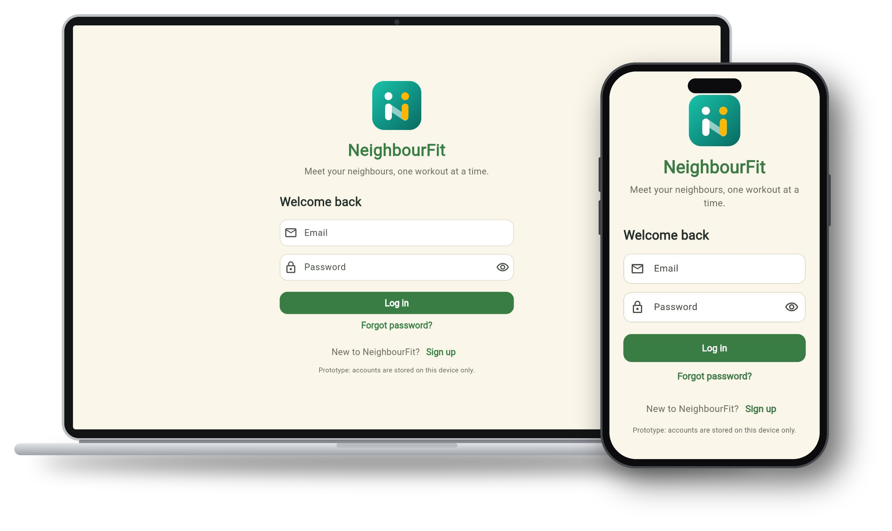

<p align="center">
  
</p>

<h1 align="center">NeighbourFit</h1>

<p align="center">
  <b>Get your neighbours moving together.</b><br>
  A community fitness app that turns neighbours into workout buddies.<br>
  Built for the Sime Darby Property University Hackathon 2026.
</p>

<p align="center">
  <a href="https://neighbourfit-24d3c.web.app/"><b>▶ Try the live prototype</b></a>
</p>

<p align="center">
  
</p>

---

## Why NeighbourFit

Many residents live a few metres apart but have never said hello. At the same time, about 1 in 3 Malaysian adults is physically inactive, and 54.4% are overweight or obese (NHMS 2023).

Research points to an opportunity:

- **Exercise is contagious.** Across 1.1 million runners, every extra kilometre friends ran led people to run 0.3 km more (Aral & Nicolaides, 2017).
- **Online contact builds real bonds.** After eight online chats, 62.5% of strangers wanted to know who the other person was, up from 17.6% after one chat (Reis et al., 2011).
- **Connected neighbourhoods are happier and safer.** Neighbourhoods with high trust and "collective efficacy" had a 39.7% lower homicide rate (Sampson et al., 1997).

NeighbourFit uses fitness as the reason to connect, so residents get healthier and get to know each other at the same time.

## Features

| | Feature | What it does |
|---|---|---|
| 📰 | **Community feed** | Share workouts and healthy meals with your whole township |
| 🏃 | **Meetups** | Tap "I'm in" to join a run, game or class nearby |
| 🎾 | **Equipment lending** | Borrow a neighbour's racket, bike or yoga mat |
| 🏆 | **Team challenges** | Hit township goals together, not against each other |
| 🎁 | **Local rewards** | Earn points and redeem vouchers at nearby shops |
| 🔎 | **AI advanced search** | Ask anything and see the most relevant results first |

## Value for Sime Darby Property

1. **More attractive townships.** Active, connected communities set townships apart and can support sales and rental demand.
2. **New commercial revenue.** Local business vouchers and sponsored fitness challenges.
3. **Better use of facilities.** Challenges bring residents to pools, courts and other shared spaces.
4. **Higher resident retention.** Friendships and recurring activities build long-term loyalty.
5. **Brand advertising.** Paid promotions from brands that want to reach township residents.

## Getting started

<!-- TODO: fill in from the repository's actual setup -->

```bash
git clone https://github.com/chew0522/NeighbourFit.git
cd NeighbourFit
# install and run steps go here
```

The live version is hosted at https://neighbourfit-24d3c.web.app/.

## Contributors

| Name | LinkedIn | GitHub |
|---|---|---|
| Chai Shun Ying | [LinkedIn](https://www.linkedin.com/in/chai-shun-ying) | [@ChaiShunYing](https://github.com/ChaiShunYing) |
| Ng Yu Hui | [LinkedIn](https://www.linkedin.com/in/yyyuhuing) | [@yuhuing](https://github.com/yuhuing) |
| Sio Zixin | [LinkedIn](https://www.linkedin.com/in/zixin-sio)) | [@Siozixin](https://github.com/Siozixin) |
| Desmond Chew Boon Cong | [LinkedIn](https://www.linkedin.com/in/desmond-chew-915256306) | [@chew0522](https://github.com/chew0522) |
